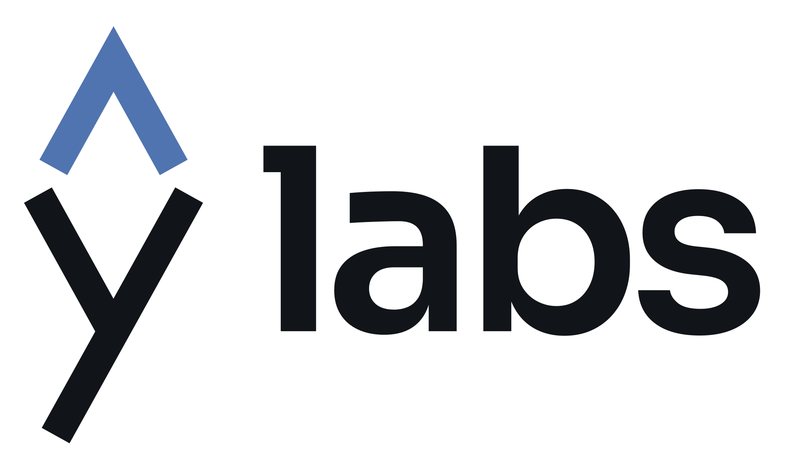

  <picture>
    <source media="(prefers-color-scheme: dark)" srcset="https://raw.githubusercontent.com/yhatlabs/.github/main/profile/logos/logo-on-dark.png">
    
  </picture>

<h3 align="center">AI made for prediction and forecasting.</h3>

YHat Labs builds foundation models for tabular and time-series data. They are pretrained like LLMs, but take structured
data as an input and return predicted values, with no training or tuning.

  <a href="https://yhatlabs.com"><b>Website</b></a> ·
  <a href="https://yhatlabs.com/models/docs"><b>Docs</b></a> ·
  <a href="https://yhatlabs.com/models/signup"><b>Get started</b></a> ·
  <a href="https://huggingface.co/yhatlabs"><b>Hugging Face</b></a>

## Our models

**Hosted:** through our API, for production and commercial use.

| Model | Data | What it does |
|---|---|---|
| [ChakraTS](https://huggingface.co/yhatlabs/ChakraTS) | Time series | Forecasting, our most accurate model |
| [ChakraTab](https://huggingface.co/yhatlabs/ChakraTab) | Tables | Prediction: classification and regression |

**Open source:** download the weights and run them on your own machine.

| Model | Data | What it does |
|---|---|---|
| [ChakraTS-OS-10M](https://huggingface.co/yhatlabs/ChakraTS-OS-10M) | Time series | Best-in-class forecasting under 100M parameters, fast on a laptop CPU |

## Repositories

<table>
  <tr>
    <td width="33%" valign="top">
      <h4><a href="https://github.com/yhatlabs/yhatlabs-python">yhatlabs-python</a></h4>
      
The Python library for our hosted models: forecasts, predictions on tables, backtests and fine-tuning.

      
<code>pip install yhatlabs</code>

      
      
    </td>
    <td width="33%" valign="top">
      <h4><a href="https://github.com/yhatlabs/yhatmodels">yhatmodels</a></h4>
      
Run our open models on your own machine, with no API key. Your data never leaves your computer.

      
<code>pip install yhatmodels</code>

      
      
    </td>
    <td width="33%" valign="top">
      <h4><a href="https://github.com/yhatlabs/yhatlabs-cookbook">yhatlabs-cookbook</a></h4>
      
Notebooks on real data, from loading it to a scored result, and our benchmark results with the code to reproduce them.

      
<a href="https://github.com/yhatlabs/yhatlabs-cookbook">Browse the recipes</a>

    </td>
  </tr>
</table>

  
  
  
   
  

